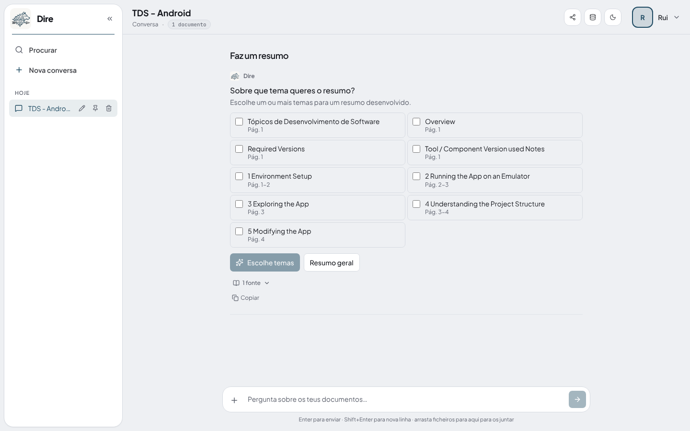
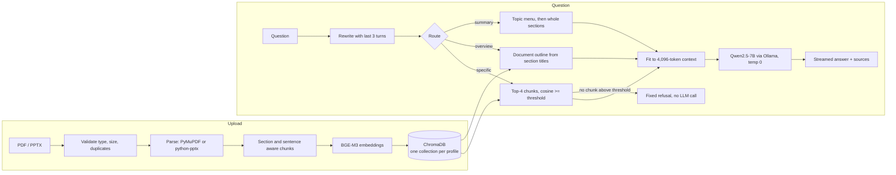

# Dire: Local RAG Assistant for Course Documents


A private, fully local question-answering assistant over your own PDFs and PowerPoint slides. Answers come only from the uploaded documents, with a citation to the file and page/slide for every fact, and the model refuses when the documents do not contain the answer. Everything runs on the local machine (Ollama + ChromaDB).

Personal project · 2026 · designed and built solo



## Overview

I built Dire to study for my Master's in Informatics Engineering (University of Minho) with lecture slides and worksheets that are mostly in Portuguese. General chatbots mix in outside knowledge and rarely say where a fact came from, so this is a **closed-book QA system** over my own material: it only uses the uploaded documents, ends every factual sentence with `[file, Pág./Slide X]`, refuses with a fixed sentence *without calling the LLM* when nothing relevant is found, and keeps everything on the local machine.

It went through a command-line "beta" (PDF only) before the current version with a web interface, document libraries, PDF export and link sharing.

## What I built

- **A structure-aware ingestion pipeline** for PDF and PowerPoint: heading detection from font statistics, section-aligned chunks of ~500 tokens with whole-sentence overlap, one chunk per slide, and page-accurate citations.
- **A retrieval and answering engine** with four answer paths (specific question, document overview, topic menu, summary of chosen topics), follow-up question rewriting and a context-budget fitter for a 4k-token local model.
- **The full application:** FastAPI backend (ChromaDB, BGE-M3 embeddings, Qwen2.5-7B through Ollama), React + Tailwind frontend with streamed answers and sources, per-profile data isolation, reusable document libraries, PDF export of conversations and a temporary share link through a Cloudflare tunnel.
- **Tools for law-style practical cases:** build a model answer from solved cases, then draft a resolution for a new case.
- **A 35-test pytest suite** that runs without downloading any model (fake LLM, hash embeddings).

## Skills demonstrated

Retrieval-augmented generation · document parsing and chunking · vector search and embeddings · prompt and context-window management · local LLM deployment · REST and streaming APIs (FastAPI) · React frontend · web security basics (sessions, CSRF, CSP, rate limiting) · automated testing

## Key design decisions

- **Chunk by structure, not by fixed size.** A heading always closes a chunk and is prepended to its text, so each chunk is about one topic, carries its section's vocabulary and can be shown as a topic in summaries.
- **Never cut a sentence.** Chunks and their 10 % overlap are made of whole sentences, so every retrieved piece is readable and quotable.
- **Cite pages precisely.** Every chunk stores its first and last page, so a chunk that crosses a page break is cited as `Pág. 3-4`.
- **Refuse before generating.** If no chunk reaches the similarity threshold, the fixed refusal is returned without calling the LLM: no invented answer and no wasted inference.
- **Budget the context explicitly.** Ollama silently drops the *start* of an over-long prompt, which is where the rules are; `fit_to_context` drops the least relevant chunks first and keeps a 15 % safety margin.
- **Summaries as a menu.** "Summarise this" returns the document's sections (no LLM call) and the user picks which ones, instead of a vague summary of a whole document that does not fit in the context.
- **Deterministic answers:** temperature 0 and a fixed seed, so the same question on the same documents gives the same answer.

## How it works



In plain terms: when a file is uploaded, its text is cut into small, self-contained pieces (chunks) that remember their file, page and section. Each chunk is turned into a vector that captures its meaning. When a question arrives, it is turned into a vector too, the most similar chunks are fetched, and only those chunks are given to a local LLM with strict instructions to answer from them and cite them.

When a file is uploaded, its text is cut into small, self-contained chunks that remember their file, page and section. Each chunk becomes a vector that captures its meaning. A question becomes a vector too, the most similar chunks are fetched, and only those are given to the local LLM with strict instructions to answer from them and cite them.

### Chunking in detail

Chunking decides what the model can ever see, so I designed it around three goals: **(1) every chunk must be citable to an exact page/slide, (2) a chunk must be about one thing, so its embedding is precise, and (3) chunks must be small enough that several fit in a 4k-token prompt**. The code is in `backend/app/services/chunking.py`, `ingest_pdf.py` and `ingest_ppt.py`.

#### PDFs (`ingest_pdf.py`)

| Decision | Value | Why |
|----------|-------|-----|
| Parser | **PyMuPDF** by default; **Docling** optional (`PDF_PARSER=docling`) | PyMuPDF is fast and gives font size, bold flags and positions per text span, which the heading detection needs. Docling is slower but sometimes reads tables better (it exports them as Markdown). |
| Reading unit | PyMuPDF text **blocks** in reading order (`sort=True`), line breaks flattened | Blocks follow the layout (a paragraph, a bullet list); flattening removes line breaks that are only due to the page width. Hyphenation at line ends is undone (`exam-\nple` → `example`). |
| Body text size | The **mode** of the font size over every character in the document | The most frequent size is the running text; anything clearly bigger is a candidate heading. |
| Heading detection | Short (< 120 chars), does not end in `. , ; :`, and either **≥ 1.15 × body size and ≥ 85 % of the largest size on that page**, or **entirely bold and < 80 chars** | The page-relative rule is for slides exported to PDF, where bullets are often bigger than the document's body text but only the slide title is close to the page's largest font. The bold rule catches headings that use the same size as the text. |
| Chunk boundaries | A heading **always closes the current chunk**; chunks never mix two sections | A chunk about one section gives a cleaner embedding and lets the section title be stored as metadata (`section_title`). It is also what powers the outline and the topic menu for summaries. |
| Heading in the text | The heading is **prepended to the chunk text** (`"Overfitting. …"`) | Questions often use the section's vocabulary; putting the title in the embedded text improves retrieval for short paragraphs. Consecutive headings with no body in between (e.g. a slide title followed by a short list) are kept inside the same chunk instead of being dropped. |
| Splitting unit | **Sentences** (split after `. ! ? ; :` followed by a capital, digit, quote or bullet) | Never cutting a sentence in half keeps every chunk readable and quotable. Very long "sentences" (tables, unpunctuated lists over ~300 tokens) are cut into 200-word pieces so one item cannot exceed the chunk size. |
| Chunk size | **~500 tokens** max (`PDF_CHUNK_TOKENS`) | Large enough for a full explanation, small enough that 4 chunks + instructions + a 500-token answer fit in the 4,096-token context of the local model. BGE-M3 handles up to 8k tokens, but long chunks dilute the embedding. |
| Overlap | **10 %** (~50 tokens, `PDF_CHUNK_OVERLAP`), made of **whole sentences** from the end of the previous chunk | Keeps the link between consecutive chunks of a long section (a definition and its example) without duplicating much text. Only applies inside a section, since section changes are natural boundaries. |
| Pages | Each chunk stores its first page and, if it runs onto the next page, `page_end` | Citations show `Pág. 3-4` instead of pointing to the wrong page. |
| Scanned pages | Pages with **< 40 characters** of text are reported as "probably images" and skipped | No OCR is done; the user is told which pages were not read instead of getting silent gaps. |
| Token counting | Estimate: **(words + punctuation) × 1.3** | Avoids loading the XLM-R tokenizer of BGE-M3 just to cut chunks; the error is a few percent and the 500 target does not need to be exact. |

#### PowerPoint (`ingest_ppt.py`)

| Decision | Value | Why |
|----------|-------|-----|
| Unit | **One chunk per slide** | A slide is already a self-contained idea and is the unit students cite ("slide 12"). |
| Content | `Slide N: <title>` header, then bullets **with their indentation level** (`  - sub-point`), tables as Markdown rows, grouped shapes flattened, shapes read top-to-bottom, left-to-right | Keeps the hierarchy of the slide, which carries meaning (a sub-bullet belongs to its parent). |
| Long slides | If a slide exceeds **800 tokens** (`SLIDE_MAX_TOKENS`), it is split by sentences into sub-chunks that **repeat the slide header** and keep the same slide number | Every piece still says which slide and topic it comes from. No overlap is used here, because the header already gives context. |
| Speaker notes | Off by default (`INCLUDE_SPEAKER_NOTES`) | Notes are often personal or noisy; they can be turned on when they contain the real explanation. |
| Empty slides | Skipped and reported | Image-only slides have nothing to embed. |

#### After chunking (`documents.py`)

- Text is normalised (soft hyphens, repeated spaces, extra blank lines) before embedding.
- Each chunk is stored in ChromaDB with metadata: `source`, `file_type`, `page_number`, `page_end`, `section_title`, `doc_id` and a scope (`conversation_id` or `lib:<library id>`).
- Uploads are validated by extension **and** magic bytes (`%PDF-`, `PK`), limited to 50 MB, and de-duplicated by SHA-256 per conversation/library.
- If anything fails half-way, the vectors and the stored file are removed, so the index never holds half a document.

### Retrieval and generation in detail

- **Embeddings:** `BAAI/bge-m3` (multilingual, good for Portuguese), normalised vectors, CPU by default, `max_seq_length = 1024`.
- **Vector store:** ChromaDB persistent client, one collection per profile (`docs_<profile>`), HNSW with **cosine** distance. Queries are filtered by the conversation's scopes (its own files + an attached library) and optionally by selected documents.
- **Query rewriting:** with history, the last **3 turns** (assistant answers cut to 300 chars) are used to turn a follow-up ("and how do you avoid it?") into a standalone question before retrieval.
- **Top-K and threshold:** **4** chunks, kept only if cosine similarity ≥ `SCORE_THRESHOLD` (0.50 in `.env.example`). If none pass, the fixed refusal is returned without calling the LLM.
- **Four answer paths** (`rag_engine.py`):
  1. **Specific question:** top-4 chunks above the threshold.
  2. **Overview question** (themes, titles, "what is this about", "what do I have to do in this worksheet"; detected by a PT/EN regex): if the whole document fits in the context it is sent in full, in order; otherwise an **outline** built from the section titles (+ first words of each section) uses 70 % of the budget and relevant chunks the rest.
  3. **Generic summary request** ("faz um resumo"): returns a **menu of the document's sections** with pages (no LLM call), as in the screenshot above.
  4. **Summary of chosen topics** ("2 and 5", a section name or "everything"): sends all chunks of those sections in page order, with a longer answer (1,000 tokens).
- **Context budget:** `fit_to_context` drops the least relevant chunks until instructions + question + chunks + answer fit in `NUM_CTX` (4,096) with a 15 % safety margin. Without this, Ollama silently cuts the *beginning* of the prompt, which is where the instructions are.
- **LLM:** `qwen2.5:7b-instruct-q4_K_M` through Ollama's `/api/chat`, **temperature 0, seed 0** (reproducible), answer up to 500 tokens, streamed to the browser as NDJSON.
- **Prompt:** a system prompt with strict rules (use only the context, refuse with the exact sentence otherwise, no prior knowledge, cite `[File, Slide/Pág. X]`), and a user message with the numbered context blocks and the question.
- **Concurrency:** one inference at a time (single-slot FIFO queue); waiting users see their position.

## Results

**Main result:** the backend test suite passes (**35/35** tests, re-run for this README with Python 3.13 and the lightweight hash embedder), and on real course PDFs the chunker produces section-aligned chunks well below the 500-token limit.

Chunking on two University of Minho course documents (the same files that are in the app's data folder):

| Document | Pages | Chunks | Tokens per chunk (min / median / max) | Chunks spanning 2 pages | Pages skipped as images | Distinct sections |
|----------|-------|--------|---------------------------------------|-------------------------|-------------------------|-------------------|
| Worksheet "First Contact with Android" (PDF) | 5 | 9 | 32 / 163 / 281 | 3 | 0 | 9 |
| Lecture slides "Android" (PDF export) | 40 | 38 | 10 / 59 / 186 | 2 | 4 (pages 4, 6, 12, 40) | 28 |

Tokens are the app's own estimate. Slides produce small chunks because each slide title closes a chunk; the worksheet's chunks follow its numbered sections (`1 Environment Setup`, `2 Running the App on an Emulator`, …), which are exactly the topics shown in the summary menu above.

The tests cover, among others: headings and page numbers, 10 % overlap, chunks crossing pages, PPTX levels/tables/long slides, refusal without LLM for out-of-document questions, follow-up rewriting, overview and topic-menu summaries, profile isolation, upload validation and rollback, queue positions, share-link limits and expiry, CSRF/security headers, PDF export and DB migration.

## Lessons learned and next steps

- **Measure retrieval, don't only reason about it.** Threshold, Top-K and chunk size were chosen by reasoning and manual tests. The next step is a small set of real questions to measure recall@k and answer faithfulness, and tune from there.
- **Heuristics meet real documents.** Font-based heading detection works on most course material, but a bold table header can look like a title, and a title repeated across slides gets duplicated. Docling's layout model is the alternative I would compare against.
- **Dense retrieval misses exact terms.** Adding BM25 (hybrid search) and a re-ranker would help with acronyms, code and exact names.
- **Next features:** OCR for scanned pages, and a learned router instead of the keyword regex that detects overview and summary questions.

## Running it locally

Requires Python 3.12, Node.js 18+ and [Ollama](https://ollama.com).

```bash
ollama pull qwen2.5:7b-instruct-q4_K_M
cd backend && python -m venv .venv && source .venv/bin/activate && pip install -r requirements.txt
cp .env.example .env && python -m app.tools.init_profiles
cd .. && ./scripts/start.sh     # http://127.0.0.1:8000
```

## References

- P. Lewis et al. *Retrieval-Augmented Generation for Knowledge-Intensive NLP Tasks.* NeurIPS 2020. [arXiv:2005.11401](https://arxiv.org/abs/2005.11401)
- J. Chen et al. *BGE M3-Embedding: Multi-Lingual, Multi-Functionality, Multi-Granularity Text Embeddings.* 2024. [arXiv:2402.03216](https://arxiv.org/abs/2402.03216)
- Qwen Team. *Qwen2.5 Technical Report.* 2024. [arXiv:2412.15115](https://arxiv.org/abs/2412.15115)
- Y. Malkov, D. Yashunin. *Efficient and robust approximate nearest neighbor search using HNSW graphs.* IEEE TPAMI, 2018.
- [Ollama](https://ollama.com), [ChromaDB](https://www.trychroma.com), [PyMuPDF](https://pymupdf.readthedocs.io), [Docling](https://github.com/docling-project/docling), [python-pptx](https://python-pptx.readthedocs.io), [Cloudflare Quick Tunnels](https://developers.cloudflare.com/cloudflare-one/connections/connect-networks/do-more-with-tunnels/trycloudflare/)

## License

Copyright © 2026 Rui Rodrigues. **All rights reserved.** The code is public so it can be viewed as part of my portfolio, but no license is granted: copying, modifying, redistributing or reusing it requires my written permission (see [LICENSE](LICENSE)). Qwen2.5 and BGE-M3 have their own licenses (Apache 2.0 and MIT respectively), and documents you upload remain subject to their authors' rights.

## Author

Rui Rodrigues ([@RuiRodrigues08](https://github.com/RuiRodrigues08)), Master's in Informatics Engineering, University of Minho.
